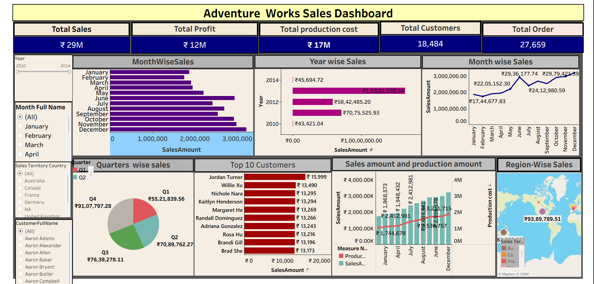
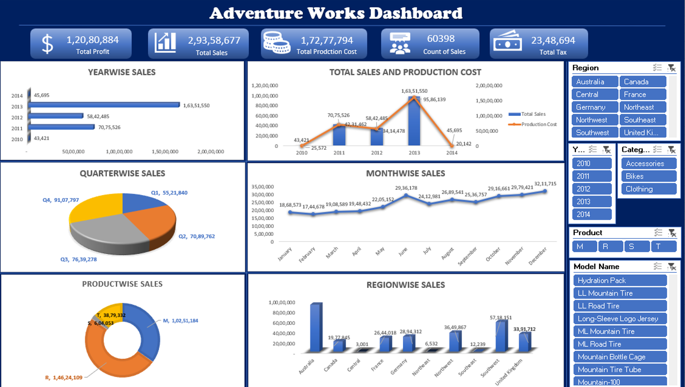
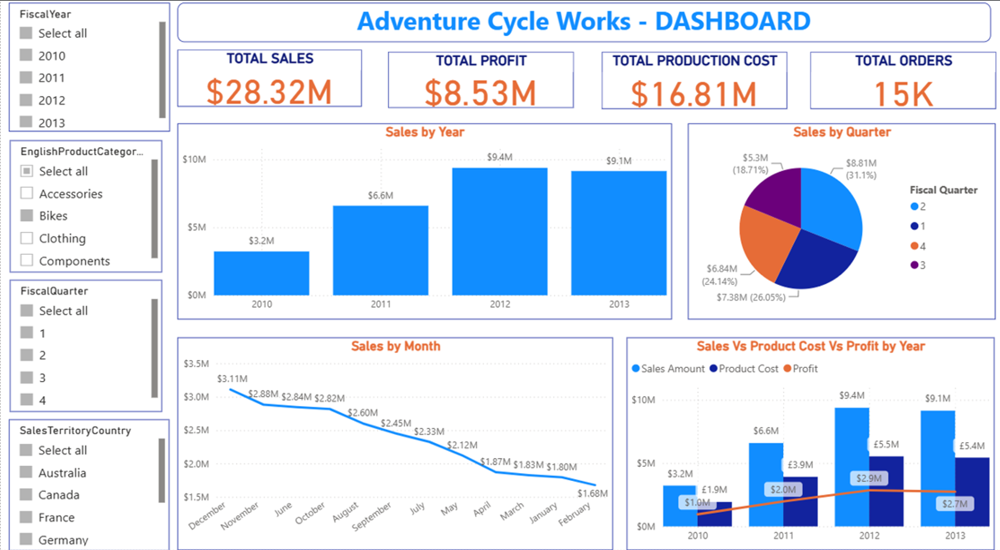

# Retail Sales Analysis | MySQL, Excel, Power BI & Tableau

## Project Overview

This project focuses on performing end-to-end retail sales analysis using the AdventureWorks dataset to evaluate business performance across sales, profitability, production costs, product categories, regional distribution, and customer trends.

The analysis involves data cleaning, transformation, SQL-based querying, KPI development, and interactive dashboard creation using MySQL, Microsoft Excel, Power BI, and Tableau.

## Project Objectives

- Analyze overall sales and profitability.
- Evaluate product and category-wise performance.
- Identify regional sales trends and distribution.
- Understand customer purchasing patterns.
- Track key business performance indicators (KPIs).
- Generate actionable insights to support business decisions.

## Tools & Technologies

| Tool | Purpose |
|---|---|
| MySQL | Data cleaning, transformation, joins, and analytical queries |
| Microsoft Excel | Data analysis, KPI calculations, and dashboard development |
| Power BI | Data analysis, KPI calculations, and dashboard development |
| Tableau | Data analysis, KPI calculations, and dashboard development |

## Project Workflow

1. Data Collection and Understanding
2. Data Cleaning and Preprocessing
3. SQL-Based Data Analysis
4. Exploratory Data Analysis
5. KPI Development
6. Dashboard Development
7. Business Insights and Recommendations

## SQL Analysis

Developed 15+ analytical SQL queries to examine different aspects of retail business performance.

Key analysis areas:

- Time-Based Analysis
- Sales and Revenue Analysis
- Product and Category Analysis
- Customer Analysis
- Regional Performance Analysis
- Profitability and Production Cost Analysis

## Key Performance Indicators (KPIs)

| Metric | Value |
|---|---:|
| Total Sales | 29.9M |
| Total Profit | 9M |
| Production Cost | 17.2M |
| Units Sold | 60.4K |

## Dashboard Previews

### 1. Tableau Dashboard



### 2. Microsoft Excel Dashboard



### 3. Power BI Dashboard



## Key Business Insights

- Evaluated overall sales performance and profitability.
- Identified high-performing products and product categories.
- Analyzed regional sales distribution and performance.
- Examined customer purchasing trends.
- Evaluated production costs in relation to sales and profitability.
- Derived business insights to identify opportunities for improving performance.

## Repository Structure

```text
AdventureWorks-DataAnalysis/
│
├── SQL/
│   └── adventureworks_analysis.sql
│
├── excel/
│   └── excel.png
│
├── power_bi/
│   └── power_bi.png
│
├── tableau/
│   └── tableau.png
│
└── README.md
```
